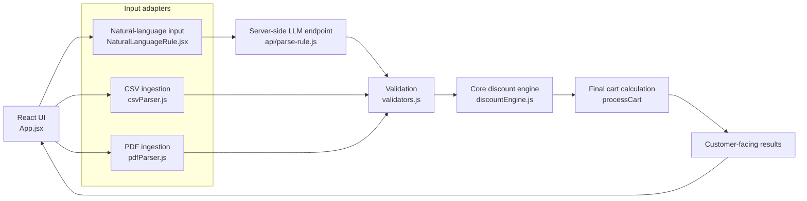

# Architecture — Opptra Discount Engine

## 1. System overview

The Opptra Discount Engine is a shopping-cart pricing application. It accepts discount rules and cart items from multiple input sources (CSV, PDF, and natural language), computes the best applicable discounts per item and at the cart level, and presents a customer-facing pricing breakdown.

The central architectural principle is a **single shared discount calculation engine**. Every input adapter converts its source into the same structured `DiscountRule` and `CartItem` models and runs them through `src/engine/discountEngine.js`. The engine has no knowledge of CSV, PDF, or LLM origins.

## 2. High-level architecture



The natural-language path is distinct: it travels through the server-side LLM endpoint before validation, while CSV and PDF are parsed client-side and validated directly.

## 3. Component responsibilities

| File | Responsibility |
|---|---|
| `src/App.jsx` | Top-level state (rules, cart items, results, errors, loading). Wires uploads, NL input, PDF import, auto-recalculation, and rendering. |
| `src/engine/discountEngine.js` | Pure business logic: rule matching, non-stackable winner selection, stackable application, item-level and cart-level pricing, final payable amount. Operates in integer paise. |
| `src/engine/csvParser.js` | Adapters from CSV text to `DiscountRule[]` / `CartItem[]` using papaparse, with row-level validation. |
| `src/engine/pdfParser.js` | Client-side PDF text extraction (pdfjs-dist), table/header detection, row reconstruction, validation, all-or-nothing cart output. |
| `src/engine/nlParser.js` | Client-side caller for `/api/parse-rule`; validates the returned rule. |
| `src/engine/validators.js` | Validation for `DiscountRule`, `CartItem`, and LLM responses (`validateDiscountRule`, `validateCartItem`, `validateLLMRule`). |
| `src/components/NaturalLanguageRule.jsx` | NL input UI, parsed-rule preview/confirmation, config notice, loading/error states. |
| `api/parse-rule.js` | Serverless handler: request validation, provider call (OpenAI-compatible), structured-output handling, fallback, normalization, error mapping. Reads `LLM_API_KEY`, `LLM_BASE_URL`, `LLM_MODEL`. |

## 4. Discount calculation pipeline

1. **Rule matching** — `ruleMatchesItem` matches brand/platform rules against an item's brand/platform (case-insensitive). Cart-scoped rules are excluded from item matching.
2. **Non-stackable selection** — among matching non-stackable rules, pick the one yielding the largest rupee saving on the item's base price. Ties broken by `ruleId`.
3. **Stackable application** — stackable rules apply sequentially on the running price, ordered percentage-first then flat, with `ruleId` tie-breaking.
4. **Percentage vs flat ordering** — percentages are applied before flats to maximize customer saving; mixed types are deterministic regardless of input order.
5. **Cart-level evaluation** — after all item discounts, sum displayed final prices into a subtotal. Eligible cart rules (subtotal ≥ `minCartValue`) compete by the same non-stackable/stackable principles on the subtotal.
6. **Final payable amount** — `finalTotal = subtotal − cartDiscount`.

Item-level and cart-level processing are kept separate: cart rules never modify individual item results.

### Monetary precision

All discount arithmetic is performed in integer paise (`toPaise`/`toRupees`). Each final item price is rounded to the nearest whole rupee before summing the subtotal. Displayed item saving is `basePrice − finalPrice` (no independent rounding). Cart discount and final total are rounded consistently. No price goes below zero (clamped).

### Numerical example (sample data)

- Cushion Cover: base ₹1,299 → platform 15% (beats brand flat ₹150) → ₹1,104.
- Bed Sheet Set: base ₹849 → brand flat ₹150, then Flipkart 10% stacked → ₹629.
- Wall Shelf: ₹599 → 15% → ₹509.
- Ceramic Vase: ₹2,499 → no match → ₹2,499.
- Cutting Board: ₹449 → 15% → ₹382.
- Desk Organiser: ₹899 → Flipkart 10% → ₹809.

Subtotal: ₹5,932. Cart rule (10%, min ₹4,000) applies → discount ₹593. Final payable: ₹5,339.

## 5. Natural-language rule pipeline

```
User description
  → POST /api/parse-rule
    → LLM provider (OpenAI-compatible, structured outputs with JSON-mode fallback)
      → JSON parse + status validation
        → validateLLMRule (server-side)
          → { ready | needs_clarification | error }
            → UI preview
              → user confirms → rule added (unique ruleId) → recalculate
              → user discards → nothing added
```

- API key is server-side only (`LLM_API_KEY`); never exposed to the frontend. `LLM_BASE_URL` and `LLM_MODEL` configure the provider.
- Missing/ambiguous input yields `needs_clarification` with missing fields; no invented values.
- Stackability defaults to `false` when unspecified.
- User confirmation is required before a parsed rule becomes active.
- Errors (auth, rate limit, timeout, malformed response, refusal) are normalized to JSON error responses.

## 6. PDF processing pipeline

1. `pdfjs-dist` extracts text items with coordinates and widths.
2. Items are grouped into lines by vertical position (y-coordinate tolerance).
3. Lines are reconstructed using actual text item x/width positions (gap-based spacing).
4. The table header (Product, Brand, Platform, Base Price) is located; lines before it are ignored.
5. Repeated headers on subsequent pages are skipped.
6. Footer/metadata lines are filtered by explicit patterns; other non-table lines with fewer than four columns are treated as errors.
7. Each data row is split into four columns; product names with spaces are preserved by joining extra leading fields.
8. Prices are strictly validated (currency symbols, thousands separators, decimals); malformed/invalid/negative/zero prices error.
9. All-or-nothing: if any product row is invalid, `data: []` with row-specific errors; the existing cart is preserved.

Limitations: text-based PDFs only (no OCR); complex or multi-column layouts may not parse correctly; coordinate-based reconstruction depends on the PDF's text layout.

## 7. Engineering decisions and tradeoffs

- **Separation of concerns**: adapters (CSV/PDF/NL) are independent of the engine. Tradeoff: more files, but each is independently testable.
- **Shared calculation engine**: one `processCart` for all inputs. Tradeoff: adapters must conform to the same models, but eliminates duplicated logic.
- **Deterministic selection**: non-stackable winner by max saving with `ruleId` tie-break; stackables ordered percentage-then-flat with `ruleId` tie-break. Tradeoff: slightly more sorting code, but reproducible results regardless of input order.
- **Integer paise**: avoids floating-point drift. Tradeoff: conversion at boundaries; display rounding can differ from exact internal values (documented).
- **Server-side credentials**: LLM key stays in serverless function/env. Tradeoff: requires a backend endpoint; local dev needs Vite middleware.
- **In-memory state**: no database/persistence. Tradeoff: state resets on refresh, but keeps the app simple and deployment-light.
- **Validation before activation**: NL rules require user confirmation; PDF/CSV errors block partial replacement. Tradeoff: more steps for the user, but prevents invalid data entering calculations.

## 8. Testing strategy

- `tests/discountEngine.test.js` — item-level and cart-level calculations, rounding, stacking, thresholds, sample expected values.
- `tests/validators.test.js` — rule/item/LLM validation, clarification, invalid inputs.
- `tests/csvParser.test.js` — CSV parsing and validation.
- `tests/pdfParser.test.js` — PDF line parsing, malformed rows, currencies, headers, all-or-nothing.
- `tests/nlParser.test.js` — client NL parser with mocked fetch.
- `tests/parseRule.test.js` — serverless handler with mocked provider (network, timeout, auth, rate limit, refusal, malformed, incomplete, fallback).
- `tests/integration.test.jsx` — end-to-end UI flows with mocked LLM/PDF, exact amount assertions.

Provider tests are mocked and do not require real API credentials. Real provider verification is separate and was performed manually with a configured key.

## 9. Known limitations

- PDF parsing is text-based only; scanned/unreadable PDFs are rejected.
- Complex PDF layouts (multi-column, nested tables) may not reconstruct correctly.
- No persistence: rules and cart reset on page refresh.
- LLM feature requires server-side configuration (`LLM_API_KEY`); otherwise disabled with a notice.
- LLM provider must be OpenAI-compatible for the structured-output path; fallback to JSON mode otherwise.
- Displayed prices are rounded to whole rupees, so internal precision can exceed displayed precision.
- No authentication or multi-user support.
